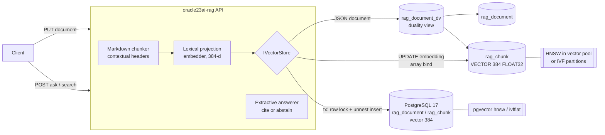
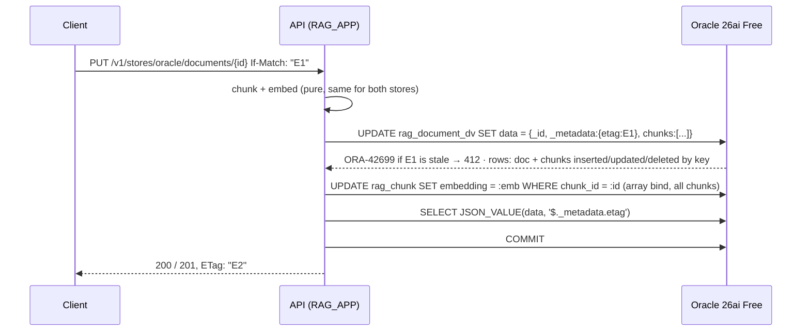

# oracle23ai-rag

[](https://github.com/hekimcan206/oracle23ai-rag/actions/workflows/ci.yml)
[](https://github.com/hekimcan206/oracle23ai-rag/actions/workflows/codeql.yml)

[](LICENSE)

Retrieval-augmented question answering on **Oracle AI Vector Search** with documents written through a **JSON
Relational Duality view** (ODP.NET), and the same pipeline on **PostgreSQL + pgvector**, compared on the same data,
the same vectors and the same index parameters, with both databases limited to the same two CPUs.

> All data is synthetic: fictional clinics in fictional Turkish towns. There is no real personal or health data.

## The problem

A team that already runs Oracle wants RAG. Most tutorials assume PostgreSQL with pgvector, and vendor material
compares nothing like for like. The questions that decide the architecture are concrete:

- Does Oracle's approximate vector search return the same neighbours as pgvector **at the same settings**, and how fast?
- What does writing a document through a **duality view** (one JSON document in, rows and an ETAG out) cost and buy,
  compared with a hand-written transaction?
- Do both stores give the **same answer and the same citation** to the same question? An exact search should, by
  definition; an approximate one may not.
- What breaks under concurrency, and what does least privilege look like for each?

## What it does

```text
$ docker compose up            # Oracle 26ai Free + pgvector + seed + API, zero manual steps
$ curl -s -X POST localhost:18424/v1/stores/oracle/ask -H 'content-type: application/json' \
       --data-binary @samples/ask-answerable.json
{"store":"oracle","answer":"The car park has 323 spaces and charges 59 TL per hour. [1]","abstained":false,
 "citations":[{"number":1,"chunkId":"isikalan-hospital-parking#0000","documentId":"isikalan-hospital-parking",
 "title":"Işıkalan Hospital — Parking","heading":"Car park","distance":0.34158219832314385}],"retrievalMs":82.53}

$ curl -s -X POST localhost:18424/v1/stores/postgres/ask ... @samples/ask-answerable.json
{"store":"postgres","answer":"The car park has 323 spaces and charges 59 TL per hour. [1]", ...
 "distance":0.34158219795438804}],"retrievalMs":17.21}          # same chunk, distance equal to 1e-9

$ curl -s -X POST localhost:18424/v1/stores/postgres/ask ... @samples/ask-unanswerable.json
{"store":"postgres","answer":"The documents do not answer this question.","abstained":true,"citations":[], ...}

$ curl -s localhost:18424/v1/stores/oracle/documents/isikalan-hospital-parking     # rendered by the duality view
{"_id":"isikalan-hospital-parking","_metadata":{"etag":"21656D9342EEE029282339576107EA94","asof":"0000000000231187"},
 "title":"Işıkalan Hospital — Parking","source":"synthetic","chunks":[{"chunkId":"isikalan-hospital-parking#0000", ...
```

(Real output from the compose demo; the first Oracle query includes a cold start.)

- `PUT /v1/stores/{store}/documents/{id}`: create or replace; `If-Match` makes it conditional (`412` on a stale ETag).
- `GET` / `DELETE` the same path; `GET` returns the JSON exactly as the database renders it.
- `POST /v1/stores/{store}/search`: `exact` or `approximate` (with `efSearch` / `probes`).
- `POST /v1/stores/{store}/ask`: an extractive answer with a citation, or an explicit abstention.
- OpenAPI + Scalar at `/scalar`, `/health/live`, `/health/ready`, JSON logs, OpenTelemetry traces and metrics.

## Architecture





## Why this design

| Decision | Alternatives | Why | ADR |
|---|---|---|---|
| One logical schema and one `IVectorStore` contract for both databases; .NET brute force as ground truth | Each database at its defaults; vendor numbers | Recall and latency are only comparable on identical vectors and identical knobs; exact search is verified before approximate search is measured | [0001](docs/adr/0001-one-schema-two-vector-stores.md) |
| Same HNSW/IVF build parameters, query knobs set per query (`EFSEARCH` = `ef_search`, `PROBES` = `probes`), 2 CPUs each | Oracle `TARGET ACCURACY` vs pgvector `ef_search` | Target accuracy is translated internally; structural parameters are the closest like-for-like | [0001](docs/adr/0001-one-schema-two-vector-stores.md) |
| Oracle writes go through a duality view; embeddings set in the same transaction, outside the document | App writes rows; vectors inside the JSON | Atomic re-ingest, no orphan chunks, server ETAG; clients never send or receive vectors | [0002](docs/adr/0002-duality-view-write-path.md) |
| Retry unconditional writes on `ORA-42698`, map it to `412` for conditional ones | Serialise with `SELECT ... FOR UPDATE` | Duality updates are lock-free; found by the 8-writer test | [0002](docs/adr/0002-duality-view-write-path.md) |
| Deterministic lexical random-projection embedder and extractive answers | Neural embedder + LLM | Reproducible numbers on any machine, no downloads; the store comparison does not depend on embedding semantics | [0003](docs/adr/0003-deterministic-embedder-and-extractive-answers.md) |

## Results

Measured with `benchmarks/OracleRag.Benchmarks`: 49,318 chunks (384-d), 300 queries, k = 10, one database at a time,
each container limited to 2 CPUs, single sequential client. Medians of three runs; host: i7-13620H, Docker Desktop
(WSL2), shared with other containers and another agent. Full method, ranges and raw output:
[docs/benchmarks.md](docs/benchmarks.md).

| | pgvector 0.8.1 (PG 17) | Oracle 26ai Free 23.26.3 |
|---|---|---|
| Exact search p50 / p95 | 25.80 / 33.35 ms | 41.13 / 51.67 ms |
| HNSW recall@10 at ef_search / EFSEARCH 40 | 0.851 (1.45 ms p50) | 0.801 (1.08 ms p50) |
| HNSW recall@10 at 160 | 0.921 (1.97 ms) | 0.870 (1.52 ms) |
| IVF (222 partitions) recall@10 at 16 probes | 0.9997 (2.31 ms) | 0.9990 (5.62 ms) |
| HNSW build (m 16, ef_construction 64) | 7.3 s, 96 MB | 9.0 s, 88 MB vector pool |
| IVF build | 1.1 s | 28.8 s |
| Write one document through the API path p50 | 2.05 ms (transaction) | 5.97 ms (duality view + embeddings + ETAG) |
| Bulk load 49,318 chunks | 1.7 s (binary COPY) | 18.5 s (array binding; 9.3-21.2 s across runs) |
| Answers cited and correct, exact search | 96.0% | 96.0% (identical) |
| Answers cited and correct, HNSW at default knobs | 82.8% (`ef_search` 40) | 86.5% (`FETCH APPROX`) |

Findings, in short:

1. **Same names, different recall.** At identical HNSW parameters Oracle returned 5-11 points lower recall than
   pgvector at every candidate-list size, at slightly lower latency. Defaults go the other way: Oracle's
   parameterless `FETCH APPROX` answered more questions correctly than pgvector's `ef_search = 40`.
2. **IVF beat HNSW on this corpus** on both databases (≥ 0.999 recall at 16 probes); neither HNSW reached 0.95 with
   m = 16 / ef_construction = 64 on these lexical vectors.
3. **Exact search at 49k vectors costs 26-41 ms** on two CPUs, and buys 9-13 points of answer accuracy over HNSW at
   default knobs.
4. **Correctness traps found by the tests:** Oracle duality-view updates fail with `ORA-42698` under concurrent
   writers instead of waiting (now retried / reported as `412`); a pgvector "exact" query with a tie-breaker in
   `ORDER BY` can still be planned through the HNSW index via an Incremental Sort (exact mode now disables index
   scans; pinned by an `EXPLAIN` test). Oracle states exactness in SQL (`FETCH EXACT`), so it has no such trap.

## Quick start

```bash
cp .env.example .env            # optional: demo defaults are built in
docker compose up               # first start: ~2 min (Oracle creates users and sizes the vector pool)
open http://localhost:18424/scalar
```

Development:

```bash
dotnet build                                                  # warnings are errors
dotnet test --project tests/OracleRag.UnitTests               # 97 unit, property, golden and API tests, seconds
dotnet test --project tests/OracleRag.IntegrationTests        # 23 tests: one contract suite x Oracle + pgvector, ~1.5 min
dotnet run -c Release --project benchmarks/OracleRag.Benchmarks -- --entities 3700 --queries 300
```

Oracle Database Free needs ~2.5 GB of RAM in Docker. The image reports itself as *Oracle AI Database 26ai Free
23.26.3*; "26ai" is Oracle's new name for the 23ai release line, and every feature used here shipped in 23ai.

## Tests

- **Unit, property, golden (97):** Turkish letter folding, chunker invariants (FsCheck: size limit, no lost words),
  embedder determinism and unit length, a pinned vector prefix (a silent embedder change would invalidate every stored
  vector), metrics, ETAG properties, answerer gates, corpus determinism and gold-answer integrity, the generated SQL of
  both stores as an approval file, the HTTP contract, and a retrieval/answer quality gate.
- **Integration (23, Testcontainers):** `VectorStoreContract` runs against Oracle and pgvector: atomic replace and
  delete, ETAG lost-update detection, 8 concurrent writers, exact search equal to the .NET reference within 1e-5, HNSW
  recall and freshness, IVF with all partitions probed equals exact, identical cited answers, dimension guards. Plus
  per-database tests: duality view rows and vectors, `EXPLAIN` plans, least privilege, embedding-model guard.

## Limitations

- **Lexical embeddings.** `lexproj-384-v1` matches words, not meaning. The recall curves describe these vectors; a
  neural embedder has different neighbourhood structure, so absolute recall at a given `ef_search` will differ. The
  database comparison (same vectors on both sides) holds; the absolute HNSW numbers do not transfer.
- **Oracle Database Free, not Enterprise Edition.** Two CPU threads, 2 GB SGA+PGA cap, vector pool sized at 512 MB for
  the benchmark. Results say nothing about EE on dedicated hardware, or about features Free lacks.
- **Small scale.** 49k vectors and 300 sequential queries on a shared laptop; no concurrency or throughput benchmark.
  Latency includes Docker Desktop port forwarding.
- **`EFSEARCH` semantics.** Oracle documents `EFSEARCH` but not its exact relationship to its graph search, so the
  HNSW rows compare matched parameter names, not proven-equal work. Oracle's `TARGET ACCURACY` sweep is not measured.
- **Answerer.** Extractive baseline: no paraphrase, no multi-chunk synthesis, name gate defeated by nested entity names
  and by lower-case questions (abstention 20/26 on the large sample vs 39/40 on the tuning set).
- **Re-embedding.** Every chunk is re-embedded on every write; `contentHash` is stored but not yet used to skip
  unchanged chunks.
- **No authentication or rate limiting** in the service; run it behind a gateway. PostgreSQL's application role has
  table DML (no duality view), so "text changes only through the document" is enforced on Oracle only.

## Next steps

- A neural embedder behind `IEmbedder` (e.g. multilingual E5-small via ONNX) and the same benchmark on its vectors.
- Oracle `TARGET ACCURACY` and larger HNSW build parameters in the sweep; concurrent-client throughput.
- Skip re-embedding unchanged chunks using `contentHash`; filtered vector search (per-tenant or per-source).
- A generative answer step with the extractive answer as a grounding check.

## Privacy note (KVKK)

KVKK (Kişisel Verilerin Korunması Kanunu) is Turkey's personal data protection law. The repository holds no personal
data. In a real deployment, treat chunks **and their embeddings** as personal data when the source documents contain
any (lexical embeddings of short texts are partly invertible), keep them in the same retention and deletion process,
and note that `DELETE` removes a document's chunks and vectors in one transaction on both databases. See
[docs/threat-model.md](docs/threat-model.md).

## License

[MIT](LICENSE)
